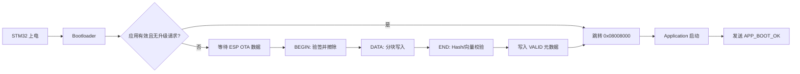

# STM32 + ESP8266 OTA 问题排查与解决记录

## 1. 项目架构与最终 Flash 布局

本项目采用 STM32F103RCT6、FreeRTOS、ESP8266 和自定义 OTA Bootloader。

| 区域 | 起始地址 | 说明 |
|---|---:|---|
| Bootloader | `0x08000000` | 上电后首先执行，负责校验、安装和跳转应用 |
| Application | `0x08008000` | FreeRTOS 主应用 |
| Metadata A | `0x0803F000` | OTA 元数据槽 A |
| Metadata B | `0x0803F800` | OTA 元数据槽 B |

最终启动及升级流程如下：



---

## 2. `Project.hex` 改到 `0x08008000` 后白屏

### 现象

- 原来直接烧录 `Project.hex` 可以运行。
- 将应用地址改为 `0x08008000` 后，LCD 白屏、按键无响应。
- 将地址改回 `0x08000000` 后又能正常运行。

### 原因

STM32 上电默认从 `0x08000000` 取主栈地址和复位向量。应用移动到 `0x08008000` 后，必须由位于 `0x08000000` 的自定义 Bootloader 跳转过去。

STM32 芯片自带的是 ROM 系统 Bootloader，主要用于串口下载等功能，需要通过 BOOT 引脚进入；它不会自动识别并跳转到本项目位于 `0x08008000` 的应用程序。

### 解决方案

- 无 OTA 架构时：应用可放在 `0x08000000`。
- 使用本项目 OTA 架构时：
  - Bootloader 放在 `0x08000000`；
  - Application 放在 `0x08008000`；
  - 工厂烧录时使用包含二者和元数据的 `factory_bundle.hex`。

仅修改：

```c
#define VECT_TAB_OFFSET 0x00008000
```

还不够。必须同时保证 Keil 链接地址也从 `0x08008000` 开始。`VECT_TAB_OFFSET` 只负责中断向量表位置，不会改变代码实际链接地址。

---

## 3. 烧录完成后必须拔掉烧录器、重新上电才能运行

### 现象

程序烧录完成后没有立即正常启动，需要拔掉 ST-Link 并重新上电。

### 原因

本设备使用电源按键和 `PWR_HOLD` 自锁电路。ST-Link、USB-TTL 或调试复位可能让 MCU 处于“有部分供电但没有完成正常按键上电时序”的状态。

### 相关启动逻辑

```c
if (Ota_BootControl_ConsumeHandoff() != 0U)
{
    BSP_Power_ResumeHold();
}
else if (BSP_Power_BootCheckAndHold() == 0)
{
    if (BSP_Power_WaitKeyPressAndHold(0) == 0)
    {
        while (1) { }
    }
}
```

- OTA/Bootloader 跳转交接时，直接恢复电源保持。
- 普通上电时，先判断是否已经满足电源按键条件。
- 如果还没有满足，则等待按下电源键并建立 `PWR_HOLD`。
- 如果建立自锁失败，则停在死循环，避免在电源不稳定状态下继续初始化电机、LCD 和任务。

### “电源自锁关闭”的含义

MCU 撤销 `PWR_HOLD` 后，硬件电源不会一定立即消失：如果手仍按着电源键，按键支路仍会暂时供电；松开按键后，`12V_SYS` 才真正断电。

### 长按开机被误判为长按关机

电源任务启动后需要先等待第一次松手，再开始计算长按关机时间：

```c
uint8_t wait_first_release = 1;
```

否则用户长按开机时，系统刚启动就可能把同一次按键继续计时为“长按关机”，表现为 LCD 刚显示又白屏。

---

## 4. 工厂整包烧录后仍然白屏

### 现象

- 单独将应用放回 `0x08000000` 可以启动。
- 烧录旧版 `factory_bundle.hex` 后，Bootloader 一直不跳转应用。
- 断开 ESP 串口、彻底断电、清除备份域仍不能解决。

### 关键日志

```text
BL_HELLO ... current_version=0 app_valid=0 metadata=1
```

### 根因

Flash 中的 Metadata B 残留了生成号更高的 `PENDING` 记录。Bootloader 按生成号选择了 Metadata B，而不是工厂包写入 Metadata A 的 `VALID` 记录，因此认为应用无效。

这不是备份寄存器或 ESP 串口造成的，而是 STM32 内部 Flash 元数据残留。

### 临时恢复方法

先烧录：

```text
factory_metadata_b_clear.hex
```

再烧录工厂包，可以让旧应用重新启动。

### 最终修复

`Tools/release_firmware.py` 已修改为生成工厂包时同时写入：

- Metadata A：有效应用记录；
- Metadata B：明确的清除数据。

因此新生成的 `factory_bundle.hex` 已包含 Metadata B 清除内容，不需要再单独烧录清除文件。

---

## 5. ESP8266 串口连接和调试信息

STM32 使用 USART2：

- `PA2`：STM32 TX；
- `PA3`：STM32 RX。

与 ESP8266 UART0 交叉连接：

| STM32 | ESP8266 |
|---|---|
| PA2 / TX | GPIO3 / RX0 |
| PA3 / RX | GPIO1 / TX0 |
| GND | GND |

ESP 的人类可读调试日志从 GPIO2/Serial1 TX 输出：

| ESP8266 | USB-TTL |
|---|---|
| GPIO2 / TX | RX |
| GND | GND |

调试波特率为 `115200`。ESP 上电最前面的乱码通常是 ROM 启动日志使用不同波特率造成的，不影响程序运行。

---

## 6. 长按升级键只有 `OTA manual check requested`

### 现象

STM32 日志只有：

```text
[INFO] KEY UPGRADE long press -> check remote firmware
[INFO] OTA manual check requested
```

随后出现：

```text
OTA waiting: 90s rx_bytes=0 valid_frames=0
OTA timeout: no ESP response
```

### 原因

升级键不会由 STM32 自己访问网络。它只向 ESP 发送 `OTA_CHECK`。如果 `rx_bytes=0`，说明 STM32 没收到 ESP 返回的数据，应检查：

- PA2/PA3 是否交叉连接；
- 是否共地；
- 两端波特率是否一致；
- ESP 是否正常启动；
- ESP 是否已连接 Wi-Fi。

### 正常手动检查流程

```text
STM32 长按升级键
-> STM32 TX OTA_CHECK
-> ESP 下载 manifest
-> 有新版本则下载并缓存固件
-> ESP TX OTA_PREPARE
-> STM32 仅在 OFF 且电机停止时 OTA_ACCEPT
-> STM32 复位进入 Bootloader 安装
```

---

## 7. Manifest 或固件下载失败

### `manifest failed status=-1`

典型日志：

```text
[HTTP] GET manifest ...
[HTTP] manifest failed status=-1
```

`-1` 表示 HTTPS 连接没有成功建立，常见原因包括：

- Wi-Fi 信号较弱；
- DNS 或 TLS 建连临时失败；
- GitHub Pages 临时不可达；
- 网络波动。

NTP 同步成功不代表后续 HTTPS 一定成功，因为二者使用不同服务器和协议。

后续如果重新检查出现：

```text
[HTTP] manifest OK bytes=382
[MANIFEST] version=10100 size=34852 current=10100
[OTA] no newer firmware
```

说明程序和服务器均正常，之前只是偶发网络连接失败，不需要修改 STM32 或重新上传固件。

### 固件 HTTP 成功但正文为 0 字节

曾出现：

```text
[DOWNLOAD] HTTP OK content_length=34852
[DOWNLOAD] stream timeout connected=0 received=0
```

原因是 GitHub Pages 的 TLS 数据记录可能大于过小的 BearSSL 接收缓冲区，而且服务器发完数据后可能关闭 TCP，但 TLS 层仍有正文数据尚未取出。

对应修复包括：

- 固件下载使用足够大的 TLS RX 缓冲区；
- 下载循环不再仅以 `http.connected()` 作为退出条件；
- 根据目标文件长度持续读取 TLS 缓冲数据；
- 增加下载空闲超时、进度、TLS 错误日志和 SHA-256 校验。

### 下载时 ESP `wdt reset`

如果日志停在：

```text
[DOWNLOAD] start ...
wdt reset
```

说明 ESP 在 HTTPS 下载阶段发生看门狗复位，此时 STM32 还没有收到 `OTA_PREPARE/BEGIN`，应用区不会被擦除。

如果只是偶发，等待自动重试即可；如果持续出现，应优先检查：

- ESP 3.3V 电源峰值供电能力；
- ESP 电源附近的电解和陶瓷去耦；
- Wi-Fi 信号强度；
- 路由器或网络稳定性。

---

## 8. `SIGNATURE_ERROR`：Bootloader 拒绝 BEGIN

### 日志

```text
[TRANSFER] RX NACK offset=0 result=9(SIGNATURE_ERROR)
```

### 根因

Bootloader 的 P-256 实现中，`U256_ModAdd()` 对 256 位加法进位的处理不正确，导致服务器生成的有效签名在 STM32 上校验失败。

### 修复

重写模加法逻辑，避免先得到已经截断的 256 位加法结果，再执行错误的模约减。修复后服务器 manifest 的签名可以在 Bootloader 上正确通过。

---

## 9. Bootloader 一直发送 `BL_HELLO`，不进入应用

### 日志

```text
BL_HELLO current_version=10100
BL_HELLO current_version=10100
...
```

或者：

```text
BL_HELLO current_version=0 app_valid=0 metadata=1
```

### 问题一：无效应用仍报告版本号

如果元数据处于 `PENDING`，其中也有目标版本号，但并不代表应用安装完成。Bootloader 若把该版本报告给 ESP，ESP 会误以为 STM32 已是最新版本，从而不再重传。

### 修复

Bootloader 只有在以下条件全部成立时才报告真实应用版本：

- Metadata 状态为 `VALID`；
- 应用向量有效；
- 应用区域 SHA-256 与 Metadata 匹配。

否则报告：

```text
current_version=0
app_valid=0
```

同时 `BL_HELLO` 增加：

- `app_valid`；
- `update_request`；
- `recovery`；
- `metadata`；
- `rx_bytes`；
- `rx_dropped`。

ESP 可以据此判断是否需要恢复中断的传输。

---

## 10. BEGIN 成功但第一个 DATA 一直超时

### 初始日志

```text
[TRANSFER] BEGIN accepted
[TRANSFER] TX DATA offset=0 len=1024
[TRANSFER] DATA ACK timeout
```

将 DATA 从 1024 字节减为 256 字节后仍然超时，说明问题并不是数据块单纯过大。

### 增加 Bootloader 分阶段诊断

增加 `BL_TRACE`：

| Stage | 含义 |
|---:|---|
| `0x10` | 已进入 BEGIN 处理 |
| `0x11` | 签名校验通过 |
| `0x12` | PENDING 元数据写入完成 |
| `0x13` | 应用区擦除完成 |
| `0x01` | 已进入 DATA 处理 |
| `0x02` | 即将写 Flash |
| `0x03` | DATA 写入 Flash 成功 |
| `0xE1` | DATA 状态错误 |
| `0xE2` | DATA 偏移错误 |
| `0xE3` | Flash 写入错误 |

### 发现的关键异常

```text
BL_TRACE stage=0x11 value=10100 offset=134224949
```

`134224949 = 0x08001C35`，这是 Bootloader 代码地址。`offset` 正常应为 0，这说明签名校验期间发生了内存破坏。

### 根因：Bootloader 主栈溢出

ARMCC 静态分析结果：

```text
原 Bootloader Stack_Size = 1024 字节
P-256 校验最大调用栈       = 2180 字节以上
```

P-256 签名校验把主栈压穿后，覆盖了相邻的 `s_parser` 和 `s_session`，因此签名看似通过，但后续 DATA 帧再也无法正确解析。

### 最终修复

将启动文件中的主栈扩大到 4096 字节：

```asm
Stack_Size EQU 0x00001000
```

修复后：

```text
BL_TRACE stage=0x11 value=10100 offset=0
BL_TRACE stage=0x01 value=256 offset=0
BL_TRACE stage=0x02 value=32 offset=0
BL_TRACE stage=0x03 value=256 offset=256
RX ACK offset=256 result=0(OK)
```

这证明协议解析和 Flash 写入都恢复正常。

---

## 11. BEGIN 第一次超时、第二次才收到 ACK

### 现象

```text
TX BEGIN attempt=1
BEGIN ACK timeout
TX BEGIN attempt=2
RX ACK result=0
```

### 原因

BEGIN 包含以下耗时操作：

1. P-256 签名校验；
2. 写入 PENDING 元数据；
3. 擦除整个应用区域。

原 ESP 只等待 30 秒，可能在 Bootloader 仍忙时就重发 BEGIN。迟到的 BEGIN ACK、周期 `BL_HELLO` 和 DATA 可能发生时序冲突。

### 修复

ESP r3 中进行了以下处理：

- BEGIN 等待时间由 30 秒提高到 120 秒；
- Bootloader 会话激活后不再周期发送 `BL_HELLO`；
- Bootloader 在长耗时操作完成后清除旧重试留下的 UART ORE/残留字节；
- DATA ACK 校验下一期望偏移，避免把迟到的 BEGIN ACK 当作 DATA ACK。

---

## 12. OTA 最终成功日志及含义

最终完整成功日志：

```text
[TRANSFER] progress=34852/34852
[TRANSFER] TX END offset=34852
[TRANSFER] RX RESULT offset=34852 result=0(OK)
[TRANSFER] complete; waiting for APP_BOOT_OK
[UART] RX APP_BOOT_OK version=10100
[CACHE] installed version confirmed; cache removed
```

含义：

1. ESP 已发送完整固件；
2. STM32 Bootloader 已完成写入；
3. STM32 已完成 SHA-256、向量和 Metadata 校验；
4. Bootloader 已跳转到新应用；
5. 新应用报告正确版本；
6. ESP 在收到 `APP_BOOT_OK` 后才删除缓存固件。

这标志着“检查—下载—缓存—安装—启动确认—清理缓存”的 OTA 闭环全部通过。

---

## 13. 更新模式状态灯改为红色

### 需求

进入更新模式后，RGB 状态灯由紫色改为红色，并在整个升级过程中保持红色。

### 修改位置

1. `Service/control_service.c`

```c
case SYS_MODE_UPDATE:
    return RGB_COLOR_RED;
```

2. `Application/task_ota.c`

```c
g_system_state.output.rgb_state = (uint8_t)RGB_COLOR_RED;
(void)RGB_Led_SetColor(RGB_COLOR_RED);
```

3. `Bootloader/boot_main.c`

Bootloader 检测到以下任一情况时主动点亮红灯：

- 有升级请求；
- 进入恢复模式；
- 当前没有有效应用；
- 收到 BEGIN。

这样应用发送 `OTA_ACCEPT` 后虽然会复位，Bootloader 仍会继续保持红灯，直到新应用启动。

当前包含该功能的 Bootloader 版本为 v8，应用版本为 `1.2.1 / 10201`。

---

## 14. Bootloader、应用版本和发布文件的关系

### Bootloader 版本

由 `Bootloader/boot_main.c` 定义：

```c
#define BOOTLOADER_VERSION 8UL
```

它只影响 `BL_HELLO` 中报告的 Bootloader 版本。

### Application 版本

由 `Common/ota_config.h` 定义：

```c
#define OTA_APP_VERSION_CODE 10201L
```

该值决定应用发送的 `APP_BOOT_OK` 版本，也必须与发布 manifest 中的 `version_code` 一致。

### `factory_bundle.hex`

生成工厂包前，必须先分别编译应用和 Bootloader。工厂包由以下部分合并而成：

```text
Bootloader.hex
+ Project.hex
+ factory_metadata.hex
+ factory_metadata_b_clear.hex
= factory_bundle.hex
```

`factory_bundle_bootloader_v8.hex` 只是对生成后的 `factory_bundle.hex` 做了一个便于辨认的复制命名；在同一次生成中两者内容相同。

---

## 15. 当前版本的编译和打包命令

### 1. 编译应用

在 Keil 中编译 `Project.uvprojx`，确认：

```text
0 Error(s), 0 Warning(s)
```

应用链接地址必须为 `0x08008000`。

### 2. 编译 Bootloader

```powershell
cmd.exe /d /c Bootloader\build_bootloader.bat
```

### 3. 生成当前 1.2.1 工厂包及 OTA 文件

```powershell
D:\software\anaconda3\python.exe Tools\release_firmware.py release `
  --version 1.2.1 `
  --version-code 10201 `
  --base-url https://kttui.github.io/hood-ota/stable
```

### 4. 校验发布文件

```powershell
D:\software\anaconda3\python.exe Tools\verify_release.py
```

正确输出应包含：

```text
factory bundle range: 0x08000000..0x0803f880
release verified: version=1.2.1 code=10201 size=35816
```

### 当前主要输出

| 文件 | 用途 |
|---|---|
| `Release/firmware/factory_bundle_bootloader_v8.hex` | ST-Link 工厂完整烧录 |
| `Release/firmware/factory_bundle.hex` | 与上述工厂包内容相同 |
| `Release/firmware/stm32-1.2.1.bin` | 上传 OTA 服务器的应用镜像 |
| `Release/firmware/manifest.json` | 上传 OTA 服务器的版本、Hash、签名和 URL |

发布命令中的 `version-code` 必须和应用实际嵌入的 `OTA_APP_VERSION_CODE` 完全一致。脚本已增加检查，版本不一致时会拒绝生成，避免出现“manifest 是一个版本、应用启动后却报告另一个版本”的问题。

---

## 16. 后续排查快速对照表

| 日志/现象 | 判断 | 优先处理 |
|---|---|---|
| LCD 白屏，`app_valid=0 metadata=1` | 应用无效或升级中断 | 检查 PENDING 元数据；必要时烧录最新工厂包 |
| `rx_bytes=0` | STM32 没收到 ESP 串口数据 | 检查 PA2/PA3、共地和波特率 |
| `SIGNATURE_ERROR` | 签名校验失败 | 检查 P-256 实现、公钥、manifest 签名 |
| BEGIN 长时间无 ACK | 验签/整片擦除尚未完成 | 使用 ESP r3 的 120 秒等待，不要复位 |
| 无 `BL_TRACE stage=0x01` | DATA 没被解析 | 检查串口残留、ORE、协议解析器和栈 |
| `stage=0x02` 后无 `0x03` | 卡在 Flash 写入 | 检查 Flash 状态和写入函数 |
| `stage=0xE3` | Flash 写入返回错误 | 检查保护、地址、擦除和供电 |
| `RESULT HASH_ERROR` | 完整镜像 Hash 不匹配 | 检查缓存文件、传输长度和服务器文件 |
| `manifest status=-1` | HTTPS 临时连接失败 | 重新检查网络、RSSI、DNS/TLS |
| `no newer firmware` | 本地版本已等于或高于服务器 | 正常结果，无需升级 |
| `APP_BOOT_OK` 后删除缓存 | 新应用已确认启动 | 正常的最终 OTA 成功状态 |

---

## 17. 最终结论

本次问题不是单一故障，而是多个问题叠加：

1. 应用地址移动后缺少正确 Bootloader/向量配置；
2. Metadata B 残留导致工厂应用被判无效；
3. P-256 模加法错误导致签名拒绝；
4. 无效应用错误报告版本导致 ESP 不重传；
5. BEGIN 长耗时造成超时重发和 UART 时序冲突；
6. Bootloader 仅有 1 KiB 主栈，P-256 校验导致栈溢出并破坏协议解析器；
7. HTTPS/TLS 和弱网络造成偶发 manifest、下载或 WDT 问题。

完成元数据清理、签名算法修复、版本状态修复、串口恢复机制、BEGIN 时序调整以及主栈扩容后，OTA 已成功完成全镜像传输、校验、启动确认和缓存删除。当前版本还增加了更新模式全程红色状态灯提示。
